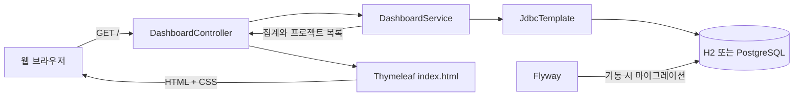

# 시스템 구조

SI 사원·프로젝트·평가·휴가 데이터를 관리하기 위한 Spring Boot 프로젝트다. 현재 구현 범위는 홈 현황 조회와 상태 확인이며, 업무 등록·수정 기능은 후속 개발 대상이다.

## 기술 구성

| 항목 | 구성 |
|---|---|
| 애플리케이션 | Spring Boot 4.1.2, Spring MVC, 내장 웹 서버 |
| 언어 | Java 21 소스·바이트코드, `JavaCompile.options.release = 21` |
| 화면 | 서버에서 Thymeleaf로 HTML을 렌더링하고 정적 CSS 제공 |
| 데이터 접근 | `JdbcTemplate`을 이용한 명시적 SQL |
| 스키마 관리 | Flyway 버전 마이그레이션 |
| 개발 DB | H2 메모리 DB, PostgreSQL 호환 모드 |
| 운영 대상 DB | PostgreSQL 17 |
| 빌드 | 저장소의 Gradle Wrapper |
| 상태 확인 | Spring Boot Actuator health |

애플리케이션 실행과 빌드에는 JDK 21 이상을 사용한다. 빌드에 사용하는 JDK는 저장소의 Gradle Wrapper가 지원하는 버전이어야 한다. 소스의 컴파일 기준은 실행 JDK와 별도로 Java 21에 고정한다. Docker 이미지와 CI는 JDK/JRE 21을 사용한다.

## 요청 처리

- `DashboardController`는 `GET /` 요청을 받아 홈 템플릿에 조회 결과를 전달한다.
- `DashboardService`는 사원·프로젝트·프로젝트평가·휴가신청 전체 건수를 조회하고, 프로젝트와 발주처를 조인한 최근 착수 프로젝트 20개를 반환한다.
- 화면에 표시하는 값은 DB에서 조회한다. DB 연결이나 SQL 오류를 0건으로 대체하지 않는다.
- 현재 서비스에는 쓰기 경로가 없다. 이후 등록·승인 기능을 추가할 때 서비스 계층에 트랜잭션과 업무 검증을 함께 둔다.

## 프로필과 데이터 수명

| 프로필 | 사용처 | DB | 데이터 수명 |
|---|---|---|---|
| `dev` | IntelliJ·로컬 기동 확인, 기본 프로필 | `jdbc:h2:mem:workforce` | 애플리케이션 프로세스가 끝나면 사라짐 |
| `prod` | 외부 DB 연동, 배포 환경 | `DB_URL`로 지정한 PostgreSQL | 연결한 DB의 저장 정책에 따름 |

`dev`의 `DB_CLOSE_DELAY=-1`은 같은 JVM이 실행되는 동안 DB를 유지하는 옵션이다. 애플리케이션 재시작 후에도 데이터가 보존된다는 의미는 아니다. `prod`는 `DB_URL`, `DB_USERNAME`, `DB_PASSWORD`를 환경변수로 받는다. 외부 DB를 사용할 때는 `SPRING_PROFILES_ACTIVE=prod`도 명시해야 한다.

## 스키마와 초기 데이터

`src/main/resources/db/migration`의 SQL을 Flyway가 기동 시 적용한다.

| 마이그레이션 | 내용 |
|---|---|
| `V1__initial_schema.sql` | 루트 엔터티 20개와 직원·평가의 하위 유형 5개, 총 25개 테이블 생성. PK/FK/UNIQUE 및 행 단위 CHECK 정의 |
| `V2__reference_data.sql` | 직무 6개, 평가항목 2개, 조회권한 2개 초기 적재 |

실제 직원·프로젝트·평가·휴가 신청은 초기 마이그레이션에 포함하지 않는다. 첫 기동에서 홈의 집계가 0이고 프로젝트 목록이 비어 있는 상태는 정상이다. 이미 적용한 마이그레이션을 수정하기보다 새 버전의 SQL을 추가해 변경 이력을 관리한다.

직원과 프로젝트 평가는 상위 키를 하위 테이블의 PK/FK로 사용하는 구조다. 사원권한, 보유기술, 프로젝트참여와 같은 교차 테이블로 다대다 관계를 해소한다. 세부 대응은 [요구사항과 구현 범위](requirements-mapping.md)를 참고한다.

## 구현 경계

| 구분 | 현재 상태 |
|---|---|
| `GET /` | DB 집계와 프로젝트·발주처 조인 조회 |
| `GET /actuator/health` | 기동·DB 상태 확인. 상세 정보는 응답에 표시하지 않음 |
| 정적 리소스 | 홈에서 사용하는 `/css/app.css` |
| 회원가입·로그인·조회권한 | 후속 구현 |
| 사원·프로젝트·투입 이력 CRUD | 후속 구현 |
| 고객·PM·동료 평가 작성 및 자격 검증 | 후속 구현 |
| 휴가 신청·승인·연차 차감·취소 | 후속 구현 |

PK/FK와 CHECK만으로 모든 업무 규칙이 보장되지는 않는다. 상위 구분값과 하위 유형의 완전 일치, 같은 프로젝트의 평가자 자격, 고객 담당자의 발주처 일치, 기간 겹침과 연차 잔량의 동시성 검사는 후속 서비스 트랜잭션에서 구현·검증해야 한다. 현재 프로젝트가 이 업무 전체를 구현했다고 해석하면 안 된다.

## 공개 자료 범위

저장소에는 직접 작성한 소스, DDL, 요구사항 요약과 팀 작성 ERD를 포함한다. 과제 원본·강의 PDF, 원본 요구사항 Excel, DA# 설치 파일과 개인 환경 파일은 포함하지 않는다. 실제 직원 식별정보나 계정 비밀값을 시연 데이터로 사용하지 않는다.
